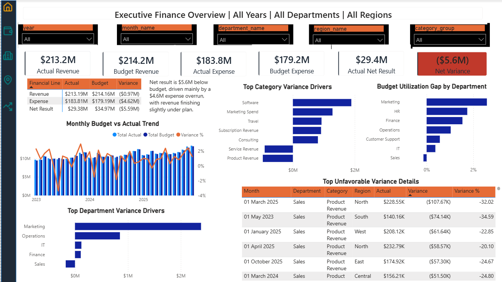
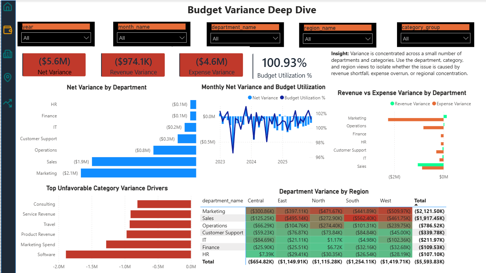
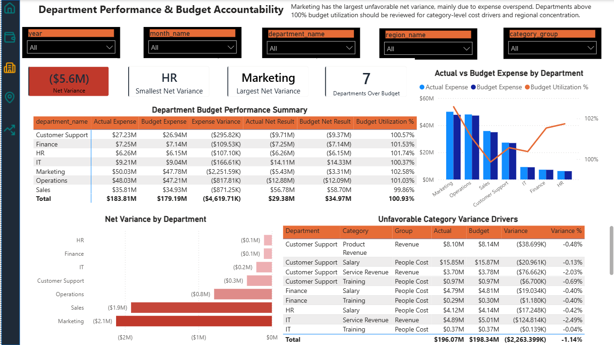
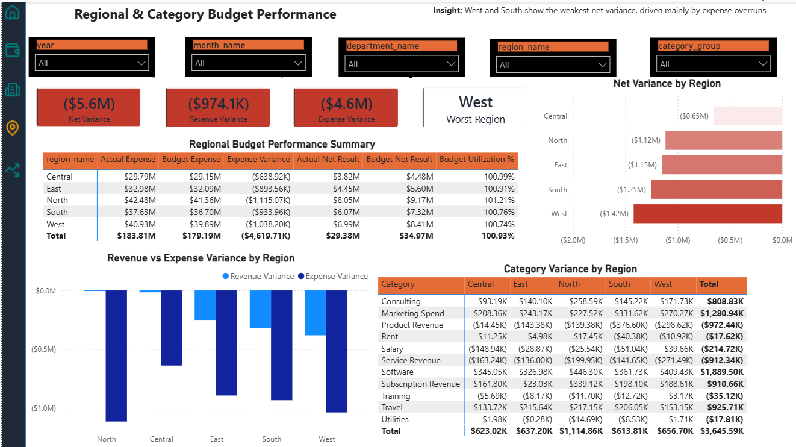
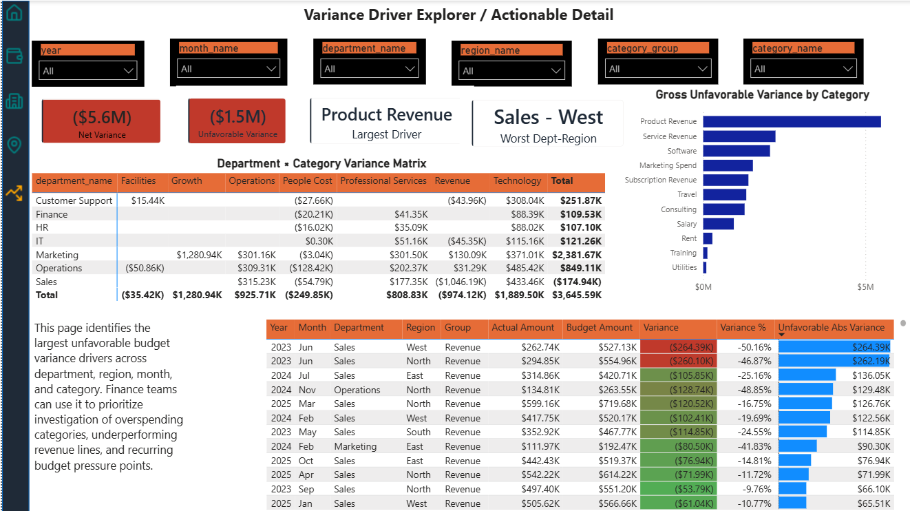

# Finance Budget vs Actual Analytics Dashboard

### An End-to-End Financial Analytics & Budget Performance Monitoring Project

## 1. Project Overview

The **Finance Budget vs Actual Analytics Dashboard** is an end-to-end financial analytics project designed to evaluate organizational financial performance by comparing actual revenue and expenses against planned budgets.

The project transforms financial data into meaningful business insights using Python for data generation, SQL Server for data storage and validation, and Power BI for interactive reporting and visualization.

It helps finance teams and business stakeholders understand where financial performance differs from expectations, identify departments and regions driving unfavorable variances, and investigate the categories responsible for budget overruns.

The dashboard provides five analytical views, ranging from an executive-level financial summary to detailed variance investigation.

**The central objective is simple: convert financial data into actionable business insights that support better budgeting, monitoring, and decision-making.**

## 2. Business Problem

Organizations prepare budgets to establish financial targets for revenue, expenses, and departmental spending.

However, actual financial performance often differs from planned budgets. Without structured reporting, identifying the reasons behind these differences can be time-consuming.

Finance teams need answers to questions such as:

- Is the organization operating above or below its overall budget?
- Which departments are contributing most to unfavorable financial variance?
- Are revenue shortfalls or expense overruns driving the financial gap?
- Which regions are experiencing the weakest financial performance?
- Which expense categories require management attention?
- How has budget performance changed over time?
- Where should management focus corrective action?

This project addresses these questions through a structured financial data pipeline and an interactive Power BI dashboard.

## 3. Project Objectives

1. Generate realistic synthetic financial data for analysis.
2. Organize budget and actual financial records into structured datasets.
3. Store and manage financial data using SQL Server.
4. perform data validation and identify data-quality issues.
5. Develop SQL reporting views for analytical consumption.
6. Create financial KPIs and variance calculations using DAX.
7. Build interactive dashboards for executive and departmental reporting.
8. Identify unfavorable variance patterns across departments, regions, and categories.

## 4. Technology Stack

| Technology | Purpose |
|---|---|
| Python | Synthetic dataset generation |
| Pandas | Data manipulation and preprocessing |
| SQL Server | Data storage and SQL-based analysis |
| SQL | Data validation, aggregation, and reporting views |
| Power BI | Interactive financial dashboards |
| DAX | KPIs, variance calculations, and financial measures |
| Power Query | Data transformation and model preparation |
| Git & GitHub | Version control and project documentation |

## 5. Dataset Description

The project uses a synthetically generated financial dataset designed to represent a realistic corporate finance environment.

It contains multiple years of monthly budget records and detailed actual financial transactions.

**Important:** The dataset is synthetic and does not contain real company, government, employee, or proprietary financial information.

### Dataset period

2023–2025

### Main data tables

**Dimension tables**

- `dim_date`
- `dim_department`
- `dim_category`
- `dim_region`

**Fact tables**

- `fact_budget`
- `fact_actuals`

### Dataset characteristics

- Monthly financial planning data.
- Revenue and expense categories.
- Department-level budget allocation.
- Region-level financial reporting.
- Transaction-level actual financial records.
- Separate dirty versions of financial fact tables.
- Seeded data-quality issues for validation exercises.

### Data-quality scenarios

The dirty datasets include examples of:

- Duplicate financial records.
- Zero or negative amounts.
- Missing dimension keys.
- Orphan actual records.
- Invalid relationships between fact and dimension tables.

These scenarios help demonstrate how data-quality validation can be incorporated into a financial analytics workflow.

## 6. End-to-End Data Analytics Workflow

The project follows a structured analytics pipeline.

```text
Synthetic Financial Data Generation
              |
              v
       Raw CSV Datasets
              |
              v
    SQL Server Data Import
              |
              v
    Data Validation & Cleaning
              |
              v
      SQL Reporting Views
              |
              v
      Power BI Data Model
              |
              v
       DAX Calculations
              |
              v
   Interactive Financial Dashboard
              |
              v
       Business Insights
```

### Step 1: Data Generation

Python is used to generate synthetic financial data representing realistic budget and actual transaction patterns.

The generated datasets include financial dimensions, monthly budgets, actual transactions, and separate datasets containing seeded data-quality issues.

### Step 2: Data Storage

SQL Server is used to organize the financial datasets into structured schemas.

The project uses:

- `staging` schema for imported raw datasets.
- `finance` schema for reporting views.

### Step 3: Data Validation

SQL validation queries are designed to examine the quality and consistency of financial records.

Validation includes:

- Row-count verification.
- Duplicate budget grain detection.
- Date dimension validation.
- Budget and actual reconciliation.
- Dimension relationship validation.
- Missing and orphan key identification.

### Step 4: Reporting Views

SQL reporting views prepare the data for Power BI consumption.

The reporting layer supports:

- Monthly budget vs actual trends.
- Department-level variance summaries.
- Regional financial summaries.
- Category-level variance analysis.
- Unfavorable variance investigation.
- Budget utilization and year-to-date reporting.

### Step 5: Power BI Data Modeling

The reporting data is connected to Power BI for analytical modeling and visualization.

Power Query handles data preparation and type transformations, while DAX measures calculate financial KPIs and performance indicators.

### Step 6: Dashboard Development

Five interactive dashboard pages provide different levels of financial analysis.

## 7. Power BI Dashboard

The dashboard contains five analytical pages.

### Page 1: Executive Finance Overview

Provides a high-level summary of organizational financial performance.

**Key metrics and visuals:**

- Actual Revenue vs Budget Revenue.
- Actual Expenses vs Budget Expenses.
- Actual Net Result.
- Net Result Variance.
- Financial performance matrix.
- Monthly Budget vs Actual Trend.
- Top Category Variance Drivers.
- Department Budget Utilization.
- Top Department Variance Drivers.
- Executive Financial Insights.



### Page 2: Budget Variance Deep Dive

Analyzes the financial differences between planned and actual performance.

**Key metrics and visuals:**

- Net Variance.
- Revenue Variance.
- Expense Variance.
- Budget Utilization Percentage.
- Net Variance by Department.
- Monthly Net Variance.
- Revenue vs Expense Variance by Department.
- Unfavorable Category Variance Drivers.
- Department Variance by Region.



### Page 3: Department Performance & Budget Accountability

Evaluates financial performance across departments.

**Key metrics and visuals:**

- Department Net Variance.
- Smallest and Largest Net Variance.
- Departments Over Budget.
- Department Budget Performance Matrix.
- Actual vs Budget Expense by Department.
- Net Variance by Department.
- Unfavorable Category Variance Drivers.

The dashboard distinguishes cost centers from revenue-generating departments rather than evaluating every department using the same performance criteria.



### Page 4: Regional & Category Budget Performance

Examines how financial performance varies across geographical regions and financial categories.

**Key metrics and visuals:**

- Regional Net Variance.
- Revenue Variance.
- Expense Variance.
- Regional Budget Performance.
- Net Variance by Region.
- Revenue vs Expense Variance by Region.
- Category Variance by Region.
- Regional Financial Insights.



### Page 5: Variance Driver Explorer

Provides a detailed investigation view for identifying the sources of unfavorable financial performance.

**Key metrics and visuals:**

- Net Variance.
- Unfavorable Variance.
- Largest Variance Driver.
- Department and Region Analysis.
- Gross Unfavorable Variance by Category.
- Department × Category Variance Matrix.
- Detailed Financial Variance Table.
- Department, Region, Category, and Month Slicers.



## 8. Key Financial Insights

The following are sample dashboard outputs from the synthetic dataset.

| Financial Metric | Actual | Budget |
|---|---:|---:|
| Revenue | $213.2M | $214.2M |
| Expenses | $183.8M | $179.2M |
| Net Result | $29.4M | $34.97M |

**Reported net result variance:** approximately -$5.6M.

### Major observations

1. The simulated organization remains profitable, with an actual net result of approximately $29.4M.
2. The organization finishes approximately $5.6M below its planned net result.
3. Expense overruns contribute approximately $4.6M to the unfavorable financial gap.
4. Revenue finishes approximately $974.1K below budget.
5. Marketing shows the largest unfavorable departmental net variance in the sample dashboard.
6. The West region shows the weakest regional net variance.
7. Software, Marketing Spend, and Travel are among the recurring expense-overrun categories.

These observations demonstrate how financial dashboards can help stakeholders move from high-level reporting to detailed variance investigation.

*All values are based on the project's synthetic dataset and should not be interpreted as real organizational financial results.*

## 9. Financial KPIs and DAX Concepts

The dashboard uses financial calculations to compare planned and actual performance.

### Budget Variance

```DAX
Budget Variance =
[Actual Amount] - [Budget Amount]
```

### Budget Utilization %

```DAX
Budget Utilization % =
DIVIDE(
    [Actual Amount],
    [Budget Amount],
    0
)
```

### Revenue Variance

```DAX
Revenue Variance =
[Actual Revenue] - [Budget Revenue]
```

### Expense Variance

```DAX
Expense Variance =
[Actual Expenses] - [Budget Expenses]
```

### Net Result

```DAX
Net Result =
[Actual Revenue] - [Actual Expenses]
```

### Net Result Variance

```DAX
Net Result Variance =
[Actual Net Result] - [Budget Net Result]
```

*These are illustrative measure definitions. The final measure names and implementations should match the actual Power BI model.*

## 10. SQL Server Workflow

SQL Server provides the structured data layer for the project.

### Database organization

**Database:** `FinanceBudgetDB`

**Schemas:**

- `staging` — imported raw financial datasets.
- `finance` — reporting views for Power BI.

### SQL scripts

```text
sql/
├── 01_create_database_and_schemas.sql
├── 02_validation_queries.sql
└── 03_reporting_views.sql
```

The scripts are organized around database creation, data validation, and reporting-layer preparation.

## 11. Project Structure

```text
Finance-Budget-vs-Actual-Dashboard/
│
├── README.md
│
├── data/
│   └── raw/
│       ├── dim_category.csv
│       ├── dim_date.csv
│       ├── dim_department.csv
│       ├── dim_region.csv
│       ├── fact_budget.csv
│       ├── fact_actuals.csv
│       ├── fact_budget_dirty.csv
│       ├── fact_actuals_dirty.csv
│       └── dq_issue_manifest.csv
│
├── scripts/
│   └── generate_finance_dataset.py
│
├── sql/
│   ├── 01_create_database_and_schemas.sql
│   ├── 02_validation_queries.sql
│   └── 03_reporting_views.sql
│
├── powerbi/
│   ├── BudgetvsActual.pbix
│   └── BudgetvsActual.pdf
│
├── screenshots/
│   ├── 01_executive_finance_overview.png
│   ├── 02_budget_variance_deep_dive.png
│   ├── 03_department_performance.png
│   ├── 04_regional_category_performance.png
│   └── 05_variance_explorer.png
│
└── icons/
```

## 12. How to Run the Project

### Prerequisites

- Python 3.x
- Microsoft SQL Server
- SQL Server Management Studio (SSMS)
- Power BI Desktop

### Step 1: Clone the repository

```bash
git clone YOUR_REPOSITORY_URL
cd Finance-Budget-vs-Actual-Dashboard
```

### Step 2: Create a Python environment

```bash
python -m venv .venv
```

Activate it on Windows:

```powershell
.venv\Scripts\Activate.ps1
```

### Step 3: Install Python dependencies

Install the packages required by the dataset generator:

```bash
pip install pandas numpy
```

If the generator requires additional packages, install them as specified in the project dependency file.

### Step 4: Generate the dataset

```bash
python scripts/generate_finance_dataset.py
```

Confirm that the expected CSV files are generated under `data/raw/`.

### Step 5: Set up SQL Server

1. Start the SQL Server instance.
2. Open SQL Server Management Studio.
3. Connect to the local SQL Server instance.
4. Execute the database and schema creation script.
5. Import the required CSV files into the staging schema.
6. Execute the validation queries.
7. Execute the reporting-view script.

### Step 6: Open the Power BI report

1. Open Power BI Desktop.
2. Open `powerbi/BudgetvsActual.pbix`.
3. Configure the SQL Server connection if required.
4. Refresh the dataset.
5. Explore all five report pages using the available slicers and filters.

**Note:** The actual database setup, CSV import, SQL execution, and Power BI refresh should be verified in the local environment before describing the complete pipeline as successfully executed.

## 13. Challenges and Solutions

### Power BI Date Parsing

Month values were initially misinterpreted during model loading.

A Power Query transformation using `Date.Day([month_start_date])` as the month component was retained as part of the date-handling workaround.

### Dataset Financial Distribution

An earlier dataset concentrated revenue in too few departments, producing an unrealistic company-wide financial result.

Revenue was redistributed across multiple revenue-generating departments, while Finance and HR remained cost centers.

This produced a more realistic simulated financial environment.

### Data Quality

Separate dirty datasets were maintained to support validation exercises without modifying the clean analytical datasets.

## 14. Business Value

This project demonstrates how structured financial data can be used to support:

- Budget monitoring.
- Expense control.
- Department accountability.
- Regional performance analysis.
- Financial variance investigation.
- Data-quality validation.
- Management reporting.

The interactive dashboard allows users to move from executive-level KPIs to detailed financial drivers, helping make the reporting process more transparent and analytical.

## 15. Future Enhancements

Potential improvements include:

- Automated SQL Server data refresh.
- Month-over-month and year-over-year financial analysis.
- Forecast vs Actual reporting.
- Budget variance alerts.
- Advanced anomaly detection for unusual financial transactions.
- Additional financial forecasting models.
- Automated data-quality reporting.

These are future enhancements and are not represented as completed functionality.

## 16. Author

**Arun Banoth**

B.Tech in Computer Science and Engineering — NIT Patna

Interested in Data Analytics, Financial Analytics, SQL, Python, and Business Intelligence.

This repository is maintained as a Data Analytics portfolio project.

---

**Project:** Finance Budget vs Actual Analytics Dashboard  
**Domain:** Financial Analytics & Business Intelligence  
**Primary Tools:** Python | SQL Server | Power BI | DAX

*Dataset values are synthetic. Project ownership and implementation credits should reflect the actual original source and contributions.*
